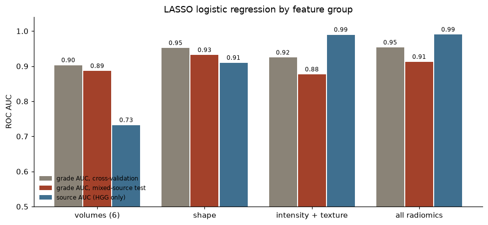
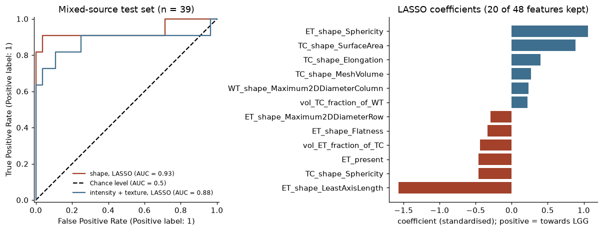
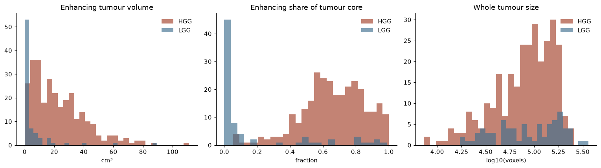

# Glioma grade prediction with radiomics

Predicting whether a glioma is low grade (LGG) or high grade (HGG) from pre-operative MRI, using radiomics
features computed inside the tumour masks of the BraTS 2020 training set (369 patients: 293 HGG, 76 LGG).

**Main finding:** in BraTS 2020 the contributing institution almost determines the grade, and intensity/texture
radiomics recognise the institution's scanner (AUC 0.99). Shape features do not depend on the scanner as much and
generalise best: ROC AUC **0.95** in cross-validation and **0.93** on the patients whose source contains both
grades.



## Data

[BraTS 2020 training data](https://www.med.upenn.edu/cbica/brats2020/data.html) (Kaggle copy:
"BraTS2020 Dataset (Training + Validation)"). Per patient: T1, T1-contrast, T2 and FLAIR, plus an expert mask with
three labels: necrotic/non-enhancing core, edema, enhancing tumour. The grade comes from `name_mapping.csv`.

The source of each case (from its BraTS 2019 ID) and its grade:

| source | HGG | LGG |
|---|---|---|
| CBICA | 129 | 0 |
| TCIA centres 01–08 | 102 | 0 |
| TCIA centres 09–13 | 0 | 65 |
| 2013 | 20 | 10 |
| TMC | 8 | 1 |
| new in 2020 | 34 | 0 |

Only the 2013 and TMC subsets (39 patients) contain both grades from the same source.

## Method

- **Features** (`src/extract_features.py`, PyRadiomics 3.0.1), 637 per patient:
  - shape of the whole tumour, tumour core and enhancing tumour;
  - first-order and texture features (GLCM, GLRLM, GLSZM) of each sequence inside the whole tumour and the core.

  Each sequence is z-scored over brain voxels first, because MRI intensities have no absolute scale.
- **Feature groups:** 6 volume features, 48 shape features, 592 intensity/texture features, and all of them together.
- **Models:** LASSO logistic regression (C tuned by inner CV), random forest and gradient boosting, all with class
  weights. Imputation, scaling and feature selection are fitted inside every training fold.
- **Evaluation:**
  1. 5-fold stratified CV repeated 3 times on all 369 patients;
  2. a **mixed-source test**: train on the other sources, test on the 39 patients from 2013 and TMC, with
     bootstrap confidence intervals;
  3. a **source test**: among HGG patients only, predict CBICA vs TCIA from the features.

  Metrics: ROC AUC, balanced accuracy, average precision for LGG.

## Results

LASSO logistic regression:

| features | grade AUC, CV | grade AUC, mixed-source test (95% CI) | source AUC, HGG only |
|---|---|---|---|
| volumes (6) | 0.90 | 0.89 (0.67–1.00) | 0.73 |
| **shape (48)** | **0.95** | **0.93 (0.77–1.00)** | 0.91 |
| intensity + texture (592) | 0.92 | 0.88 (0.67–1.00) | 0.99 |
| all radiomics (640) | 0.95 | 0.91 (0.70–1.00) | 0.99 |

Random forest and gradient boosting give the same picture (all results in `results/*.csv`).

- **Enhancement decides most cases.** Every HGG has an enhancing part; 27 of 76 LGG have none.
- **Texture features carry a scanner fingerprint.** They identify the source almost perfectly even after
  normalisation, and lose more than shape features on the mixed-source patients.
- **Selected model:** LASSO logistic regression on the shape features. It keeps 20 of the 48 features.





## Limitations

- The mixed-source test set is small (39 patients, 11 LGG), so its confidence intervals are wide.
- Features are computed from expert masks; an automatic segmentation would add error.
- Shape features still carry some source information (AUC 0.91), probably from site-specific annotation, so even
  the shape result is likely somewhat optimistic.
- BraTS only labels LGG vs HGG. WHO 2021 grading also uses molecular markers (IDH, 1p/19q) that are not available.

## How to run

```bash
python3.11 -m venv .venv
.venv/bin/pip install "numpy<2" setuptools wheel versioneer
.venv/bin/pip install --no-build-isolation pyradiomics==3.0.1
.venv/bin/pip install -r requirements.txt

# 1. data: download BraTS2020_TrainingData.zip (~3.3 GB) from Kaggle, then
.venv/bin/python src/prepare_data.py --zip ~/Downloads/BraTS2020_TrainingData.zip   # writes data/brats2020 (~3 GB)

# 2. radiomics features (~6 min with 6 workers)
.venv/bin/python src/extract_features.py --workers 6                                 # writes data/features.csv

# 3. analysis
.venv/bin/jupyter notebook notebooks/grade_radiomics.ipynb
```

The MRI data and the feature table are not included in the repository.

## Project structure

```text
src/prepare_data.py          zip -> compressed NIfTI, fixes the misnamed mask of case 355
src/extract_features.py      PyRadiomics feature extraction (parallel)
src/modeling.py              feature groups, model pipelines, evaluation helpers
notebooks/build_notebook.py  builds the analysis notebook
notebooks/grade_radiomics.ipynb
results/                     result tables and figures
```
